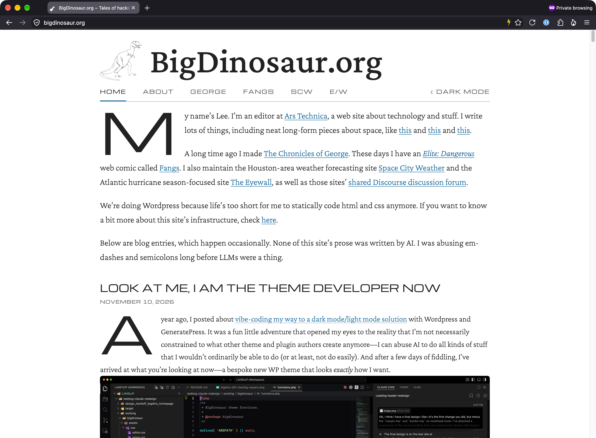
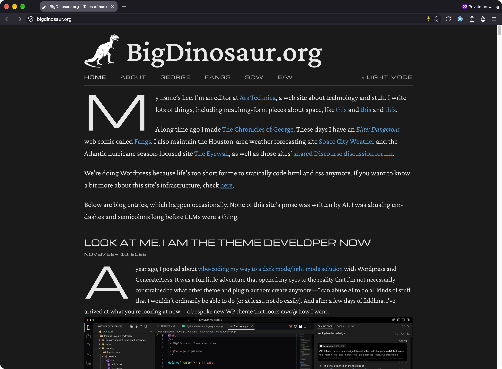

*This document was LLM-generated.*

# BigDinosaur WordPress theme

The theme behind [bigdinosaur.org](https://bigdinosaur.org): a reading-focused,
single-column blog theme with a light/dark scheme toggle, self-hosted fonts
with metric-matched fallbacks, complete Open Graph and Twitter card metadata,
in-place loading of older posts, and Prism syntax highlighting on posts tagged
`code`. It is a classic (PHP template) theme, not a block theme.

It is published as a reference. It was written for one site and carries that
site's name, mascot, footer links and copy. You are welcome to use or adapt it
under the GPL, but expect to change those things; see
[What is site-specific](#what-is-site-specific).

| Light | Dark |
|---|---|
|  |  |

## What it does

- **Typography.** Crimson Pro for reading text and the site title, Michroma
  for uppercase post and archive titles, headings, drop caps and small labels,
  Jost for minor headings and captions, IBM Plex Mono for code. All four are
  bundled as latin-subset WOFF2 files and preloaded where they paint above the
  fold. Each has a `size-adjust`/`ascent-override` fallback face (Georgia,
  Arial, Menlo on macOS and Windows; Noto Serif and Roboto on Android) so text
  does not reflow when the web font arrives.
- **Color scheme.** Light by default, dark on request. A tiny inline head
  script sets `html[data-scheme]` from `localStorage` or the OS preference
  before first paint; a masthead button toggles it. Without JavaScript the
  stylesheet follows the OS.
- **Head metadata.** Description, `color-scheme` and `theme-color` hints, a
  self-canonical on every page including `/page/N/`, Open Graph and Twitter
  cards, and the `article:*` set on posts. A post shares its featured image,
  else its first body image when wide enough, else the site card. Tag and
  category archives are `noindex, follow`.
- **Post list.** The home page and archives show excerpts (the More block
  decides where). `assets/js/post-list.js` loads older pages in place as you
  scroll, updating the URL so reload and Back land in the right place, and
  falls back to the ordinary pagination links whenever anything is off.
- **Editor.** Color palette and font-size presets match the front end;
  `assets/css/editor.css` mirrors the look in the block editor.
- **Less of WordPress.** Emoji scripts, RSD/WLW links, the generator tag and
  the Dashicons dependency are removed. The only JavaScript is the two inline
  scheme scripts, the post-list loader on lists, and Prism on `code` posts.

## Requirements

WordPress 6.6 or later (tested to 7.1), PHP 8.1 or later. There is no build
step: the CSS and JavaScript are served exactly as they appear in this
repository.

## Install

Copy the `bigdinosaur/` directory to `wp-content/themes/bigdinosaur/` and
activate it. Then:

1. Assign a menu to the **Primary** location (one level deep).
2. Optionally create a synced pattern with the slug `homepage-intro`; it is
   shown above the post list on the first page of the blog.
3. Tag posts `code` to get Prism highlighting on them.
4. Set a featured image on a post when you want it as the share image.

## What is site-specific

Change these if you reuse the theme for another site:

- `footer.php`: the copyright line names BigDinosaur.org and links to
  `/copyright-statement/` and `/email/`.
- `functions.php`: `bigdinosaur_tagline()` turns the author's name in the
  site tagline into an e-mail link. No template prints the tagline, so this
  helper only matters if you add one. The fallback share-card alt text in
  the same file describes the site card.
- `assets/images/`: the mascot (`bigdino-left-cleanbg-square.png`, used in
  the masthead and on the 404 page) and the 1200x630 share card (`card.png`).
- `404.php`: the copy.
- `style.css` header: theme name, author and URI. The `bigdinosaur` text
  domain and function prefix are used throughout.

## Layout

```text
bigdinosaur/
  style.css                 theme header, @font-face rules, tokens, all styles
  functions.php             setup, enqueues, head metadata, navigation helpers
  header.php footer.php     masthead with mascot, title, menu, scheme toggle
  index.php                 post list (home and archives)
  single.php page.php       single post, static page
  404.php                   not-found page
  template-parts/content-summary.php
  assets/css/editor.css     block editor styles
  assets/css/prism.css      PrismJS Okaidia theme (MIT)
  assets/js/post-list.js    in-place loading of older posts
  assets/js/prism.js        PrismJS 1.30.0 bundle (MIT)
  assets/fonts/*.woff2      Crimson Pro, Jost, Michroma, IBM Plex Mono (OFL)
  assets/images/            mascot and share card
  ASSET-NOTES.md            design and maintenance notes for the CSS and JS
  LICENSES/PrismJS-MIT.txt  PrismJS license (also reproduced in both Prism files)
  LICENSES/OFL-fonts.txt    font copyright lines and the SIL Open Font License 1.1
screenshots/                the two images above
tools/font-metrics.py       regenerates the fallback @font-face metrics
```

The CSS and JavaScript carry short comments where a rule is not self-evident.
The longer reasoning, and the numbers behind the layout formulas, are in
`bigdinosaur/ASSET-NOTES.md`; update it alongside any change to the assets.

## Static publishing

The site this theme serves is published as static HTML by a companion plugin,
[bigdinosaur-static](https://github.com/code-a-saurus/BigDinoBlogStaticPlugin),
which makes WordPress render each page without core's CSS and scripts and
validates the result against the theme's exact head. That is why the theme
enqueues plain tags only, prints its metadata itself, and treats its head as a
contract: the plugin refuses to run with a theme older than the version it
was written for. The plugin also compiles `style.css` into the public
stylesheet (header removed, font URLs and block class names mapped), copies
`post-list.js` byte for byte, and refuses either if the result contains
`wp-`, `wp_` or `WordPress`, so keep those strings out of both files. The
theme works on its own without the plugin.

## Licenses

The theme is GPL-2.0-or-later (see `LICENSE`), the same license as WordPress
itself. Third-party pieces keep their own terms, collected in
`bigdinosaur/LICENSES/` so they travel with the installed theme:

- **PrismJS 1.30.0 and the Okaidia theme** (`assets/js/prism.js`,
  `assets/css/prism.css`): MIT, copyright Lea Verou. Each file opens with the
  full MIT notice (copyright line and permission text), so any copy of the
  file carries its license; the same text is in `LICENSES/PrismJS-MIT.txt`.
- **Fonts** (`assets/fonts/*.woff2`): Crimson Pro, Jost, Michroma and IBM Plex
  Mono are distributed under the SIL Open Font License 1.1 by their authors;
  the files here are latin subsets. Each font's copyright line and the OFL
  text are in `LICENSES/OFL-fonts.txt`.
